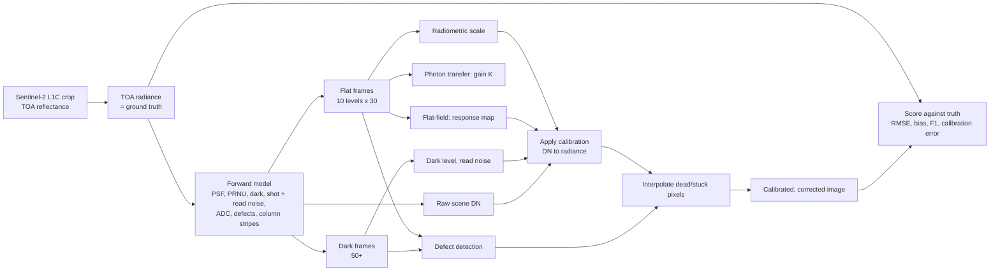
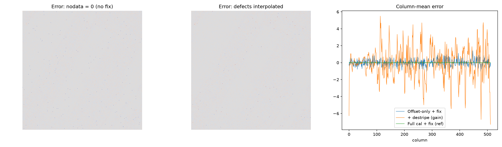
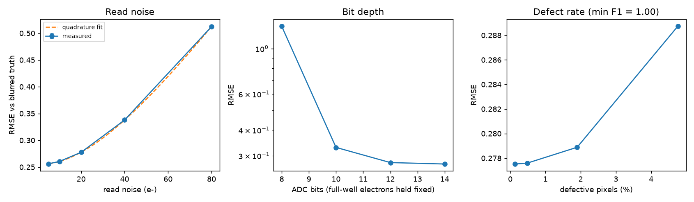
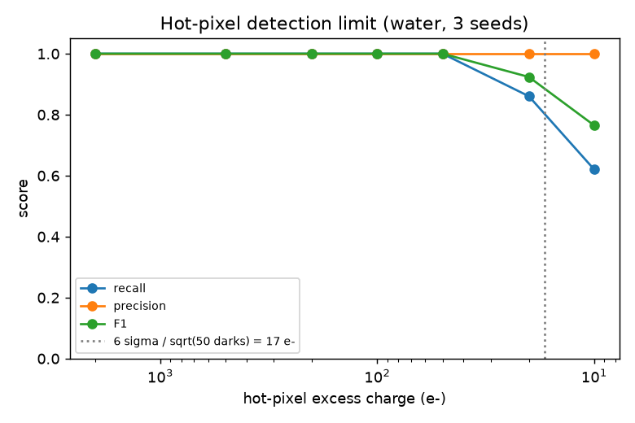
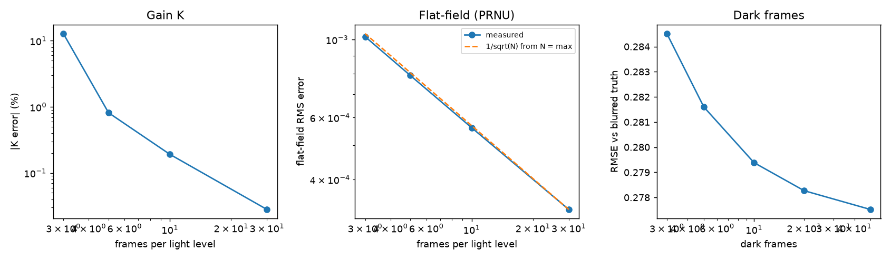
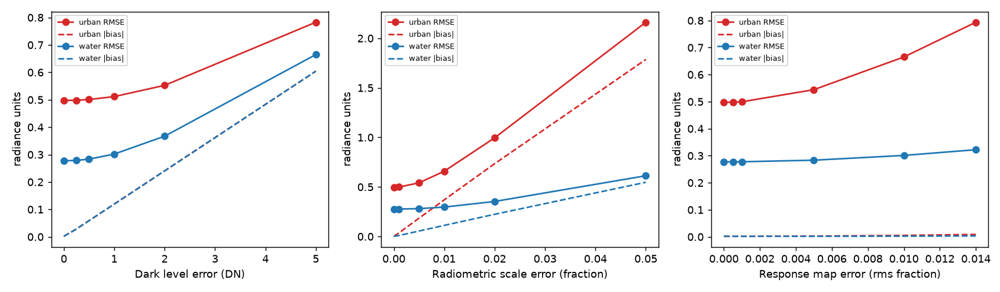
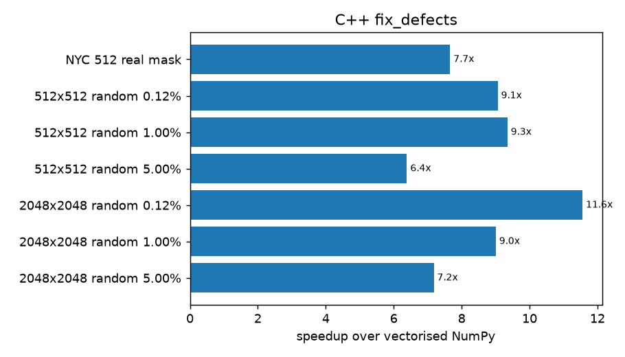

# Physics-based push-broom sensor simulator and radiometric calibration pipeline

Simulate a push-broom satellite sensor, produce raw data with known errors, calibrate and correct that data using only *estimated* parameters, then measure how close the result is to the known truth.

Reference sensor: Sentinel-2 MSI band B4 (red, 10 m). Scenes: a 512 x 512 urban crop (New York City) and a 256 x 256 open-water crop (western Long Island Sound), both from one Sentinel-2 L1C tile (T18TWL).

## The idea

Real satellite data has errors, and you never know the true answer. So the problem is turned around:

1. **Start from a known truth.** A real Sentinel-2 crop becomes the "perfect" scene (true radiance).
2. **Break it on purpose.** The simulator mimics the sensor chain: optical blur, photon (shot) noise, read noise, per-pixel sensitivity differences (PRNU), dead / hot / stuck pixels, per-column gain and offset errors (stripes), and conversion to digital numbers (DN). The exact errors are saved.
3. **Repair it blind.** The calibration code sees only the raw scene and calibration frames (darks and flats), like an engineer would. It never reads the simulator config or the saved truth.
4. **Score the repair.** Because the truth is known, the remaining error can be measured.

## Pipeline



All logic lives in `src/sensorsim/`. Experiments in `experiments/` only call it.

## Results

All numbers are from real runs with seed 42 unless stated. "Truth" means simulator truth passed through the sensor PSF (the *blurred* truth), which isolates the radiometric error. The PSF blur itself is not removed, because there is no deconvolution step.

### Calibration recovery (urban scene, 50 darks, 10 flat levels x 30 frames)

| Quantity | Estimated | True | Error |
| --- | --- | --- | --- |
| Gain K (e- per DN) | 22.003 | 22.000 | +0.01% |
| Read noise (e-) | 20.13 | 20.0 | +0.6% |
| Dark level (DN) | RMS error 0.135 | | theory 0.14 |
| Radiometric scale (DN per radiance unit) | 8.2497 | 8.2541 | -0.054% |
| Flat-field non-uniformity | 1.430% before, 0.033% after | | 44x lower |
| Column gain error | 0.011% | | |

### Radiometric correction (urban scene, defect pixels excluded)

| Variant | RMSE | Bias |
| --- | --- | --- |
| No correction | 12.157 | +12.13 |
| Offset only | 0.791 | |
| **Full pipeline** | **0.471** | +0.002 |
| Oracle (true parameters) | 0.470 | |

The full pipeline matches the oracle (ratio 1.000). The remaining error is the shot + read noise floor, which no calibration can remove. Column stripe RMS falls from 0.386 (offset only) to 0.0205 (full), a 19x reduction.

Against the *sharp* truth the full RMSE is 3.089 (8.2% of the mean), about 95% of which is PSF blur.

### Two scenes, whole image including interpolated defect pixels

| | Urban | Water |
| --- | --- | --- |
| Mean radiance | 37.5 | 11.5 |
| RMSE | 0.497 | 0.277 |
| RMSE as % of mean | 1.32% | 2.41% |
| Gain K error | +0.014% | -0.034% |
| Flat-field RMS error | 0.00033 | 0.00033 |
| Detection F1 | 1.00 (322 defects) | 1.00 (93 defects) |

The 0.497 includes the defect pixels (interpolated), which is why it is above the 0.471 floor measured with defects excluded. The water scene has a lower absolute error but a higher relative error, because shot and read noise are a bigger share of a small signal.

### Defect detection and correction (urban scene, 322 defects = 0.123%)

Detection: precision = recall = F1 = 1.00 (dead 119, stuck 45, hot 158). This is the easy case (extreme defects, many frames). The sweeps below show where it stops being easy.

| Fix strategy | Whole-image RMSE | Defect-pixel RMSE |
| --- | --- | --- |
| Zero-fill | 1.205 | 31.7 |
| Mean-fill | 0.755 | 16.8 |
| **Interpolate dead/stuck only** | **0.497** | 4.6 |
| Interpolate all detected | 0.527 | |
| Noise floor | 0.471 | |

Interpolating dead/stuck pixels reduces whole-image RMSE by 34% against mean-fill and 59% against zero-fill.



### Sensitivity sweep (water scene, mean of 3 seeds)



| Read noise (e-) | 5 | 10 | 20 | 40 | 80 |
| --- | --- | --- | --- | --- | --- |
| RMSE | 0.256 | 0.260 | 0.2775 | 0.338 | 0.512 |

RMSE follows shot noise and read noise added in quadrature.

| ADC bits | 8 | 10 | 12 | 14 |
| --- | --- | --- | --- | --- |
| RMSE | 1.286 | 0.329 | 0.2775 | 0.273 |
| K error | -9.8% | -0.011% | -0.028% | -0.030% |

The bit-depth sweep scales K by 2^(12 - bits) so full-well electrons stay fixed and only quantisation changes. 10 to 14 bits behave alike. At 8 bits one DN is 352 e-, shot noise is far below one DN, and the K estimate fails.

| Defect rate (x baseline) | 1 | 4 | 16 | 40 |
| --- | --- | --- | --- | --- |
| Defective pixels | 86 | 316 | 1245 | 3119 |
| RMSE | 0.2775 | 0.2776 | 0.2789 | 0.2887 |
| F1 | 1.00 | 1.00 | 1.00 | 1.00 |

### Where detection breaks, and how many frames are needed



| Hot-pixel excess (e-) | 2000 | 100 | 50 | 20 | 10 |
| --- | --- | --- | --- | --- | --- |
| Recall | 1.00 | 1.00 | 1.00 | 0.86 | 0.62 |
| Precision | 1.00 | 1.00 | 1.00 | 1.00 | 1.00 |

Weak hot pixels are missed, but none are invented. A rough estimate of the limit, 6 x (read noise / sqrt(50 darks)), is about 17 e-, which is in the region where recall starts to fall. That estimate is a back-of-envelope check, not something the detector reports.



| Frames per flat level | 30 | 10 | 5 | 3 |
| --- | --- | --- | --- | --- |
| \|K error\| | 0.028% | 0.19% | 0.81% | 12.8% |
| Flat-field RMS error | 0.00033 | 0.00056 | 0.00079 | 0.00102 |

Flat-field error follows 1/sqrt(N). K error grows much faster and fails at 3 frames, so use about 10 or more frames per level. Dark frames matter little: RMSE rises from 0.2775 (50 darks) to 0.2845 (3 darks).

### Wrong calibration parameters: how errors reach the image



Estimated parameters were deliberately corrupted before applying them.

- **Dark level:** a 1 DN error gives a bias of about -0.12 radiance units on both scenes. The same absolute error hurts dark scenes more in relative terms.
- **Radiometric scale:** a 1% error gives a bias of about -0.37 on urban and -0.11 on water, proportional to scene brightness.
- **Response map:** a random per-pixel error acts like extra noise with near-zero bias. At 1.4% rms (about the raw PRNU size) urban RMSE rises from 0.497 to 0.794.

Roughly, the calibration errors achieved here sit about an order of magnitude inside the point where RMSE degrades by 10%.

### C++ speedup



`fix_defects` (mean of valid 8-neighbours, filled in passes) was ported to C++ with pybind11 and checked to give the same output as the NumPy version.

| Case | NumPy (ms) | C++ (ms) | Speedup |
| --- | --- | --- | --- |
| NYC 512, real mask (322 defects) | 15.14 | 1.98 | 7.7x |
| 512 x 512, 0.12% / 1% / 5% | 15.5 / 15.6 / 15.2 | 1.7 / 1.7 / 2.4 | 9.1 / 9.3 / 6.4x |
| 2048 x 2048, 0.12% / 1% / 5% | 356 / 298 / 307 | 31 / 33 / 43 | 11.6 / 9.0 / 7.2x |

Medians of repeated runs, one machine, one call from Python. The NumPy baseline does 8 shifted full-image operations per pass, while the C++ version visits only the defective pixels, so the speedup comes from both the language and the sparse algorithm.

## Findings worth knowing

- **Hot pixels are not interpolated.** A hot pixel here is fixed excess charge, so per-pixel dark subtraction already removes it. Interpolating them made the result worse (0.497 to 0.527), so detected does not mean should be fixed.
- **Scene-based destriping failed, on both scenes.** On urban, real vertical structure (column-median jumps of about 2 radiance units) is about 5x larger than the stripes (about 0.4), and RMSE rose from 0.53 to 2.2. On water the stripe RMS after calibration (0.0168) is already at the noise floor expected from random noise alone (0.277 / sqrt(256) = 0.017), so destriping only added noise (RMSE 0.2773 to 0.2784, stripe RMS 0.0168 to 0.030). Calibration-based stripe removal is the right method when flat frames exist. Destriping is not in the default pipeline.
- **K does not enter the radiance chain.** The radiometric scale comes from flats at known radiance, so a wrong K changes the noise model and SNR, not the calibrated radiance.
- **Dark current is not recoverable here.** At 1.5 ms integration time the true dark current is only about 0.075 e-, so offset and dark signal cannot be separated. The pipeline estimates their sum.

## Assumptions

- Work in electrons until the ADC stage. DN = clip(round(E / K + offset), 0, 2^bits - 1).
- Baseline sensor (`configs/sensor_baseline.yaml`): K 22 e-/DN, offset 100 DN, 12 bit, read noise 20 e-, integration time 1.5 ms, PSF sigma 0.5 px. The comments in that file give the source of each value.
- Radiance from reflectance: L = rho * E_sun * cos(theta_s) / (pi * d^2), using the scale factor and radiometric offset from the product metadata.
- The discrete 0.5 px Gaussian kernel has an effective sigma of about 0.46.
- Hot pixels are modelled as a fixed excess of 2000 e- (about 90 DN), because real dark current is invisible at this integration time.
- Stripes are per-column gain and offset errors, as in a push-broom sensor where each detector element produces one image column.
- Seeds: the fixed pattern (truth) and the noise use separate streams, `default_rng([seed, 0])` and `default_rng([seed, 1, frame_tag])`, so every run is reproducible from the YAML and the seed.

## Limitations

- **This is a self-consistency check, not proof it works on real hardware.** The estimators use the same physics as the simulator, so very small errors (K within 0.01%, F1 = 1.0) are expected. Real sensors have effects not modelled here.
- Validated against known ground-truth radiance (PSF-blurred), not against a reference product.
- Detection F1 = 1.0 is the easy case (extreme defects, 560 frames). The sweeps show where it breaks.
- Sweeps use one scene (water), 3 seeds per point, and one sensor configuration.
- No deconvolution, so the PSF blur remains in the error against the sharp truth.
- The 14-bit setting shows a flat-field error about 3x the other bit depths. It is unexplained and has not been investigated.
- Saturated pixels are excluded from the error metrics; none occurred in the runs above.

## Out of scope

Orthorectification, RPC models, atmospheric correction (L1C to L2A), geometric accuracy, deconvolution, and denoising.

## Future work

- Per-line geometric shifts estimated with phase correlation.
- MTF50 from a slanted edge, and Spectral Angle Mapper for spectral fidelity.
- Destriping when calibration frames are missing or poor (offset-only baseline).
- Test the hot-pixel detection limit against the number of dark frames.
- Investigate the 14-bit flat-field result.
- Replace simulated frames with real sensor frames.

## Reproduce

```powershell
python -m venv .venv
.\.venv\Scripts\Activate.ps1
pip install -e .
pytest
```

Data: download the Sentinel-2 L1C product named in `configs/scene_nyc.yaml` (product `S2B_MSIL1C_20260829T153809_N0512_R011_T18TWL_20260829T191906`) from the Copernicus Data Space and unpack it under `data/`. The `data/` folder is gitignored. The water scene uses the same tile (`configs/scene_water.yaml`).

Run the experiments in this order (each reads the saved outputs of earlier ones):

```powershell
python experiments\00_simulate_scene.py
python experiments\01_calibration_recovery.py
python experiments\02_radiometric_baselines.py
python experiments\03_defect_detection.py
python experiments\04_defect_correction.py
python experiments\06_water_scene.py
python experiments\07_two_scenes.py
python experiments\08_destripe_water.py
python experiments\09_sweep.py
python experiments\10_detection_limits.py
python experiments\11_wrong_parameters.py
```

The C++ module needs a C++17 compiler (MSVC Build Tools on Windows):

```powershell
python setup_cpp.py build_ext --inplace
pytest tests/test_fix_defects_cpp.py
python experiments\12_benchmark_cpp.py
python experiments\13_make_figures.py
```

If the extension is not built, the C++ tests are skipped and the rest of the pipeline works with the NumPy version.

## Layout

```
configs/        sensor_baseline.yaml, scene_nyc.yaml, scene_water.yaml
src/sensorsim/  scene/, forward/, calibration/, correction/, utils/, pipeline.py
src/sensorsim/cpp/fix_defects.cpp    C++ defect interpolation (pybind11)
experiments/    one script per experiment
tests/          pytest
results/        figures and result files
```
